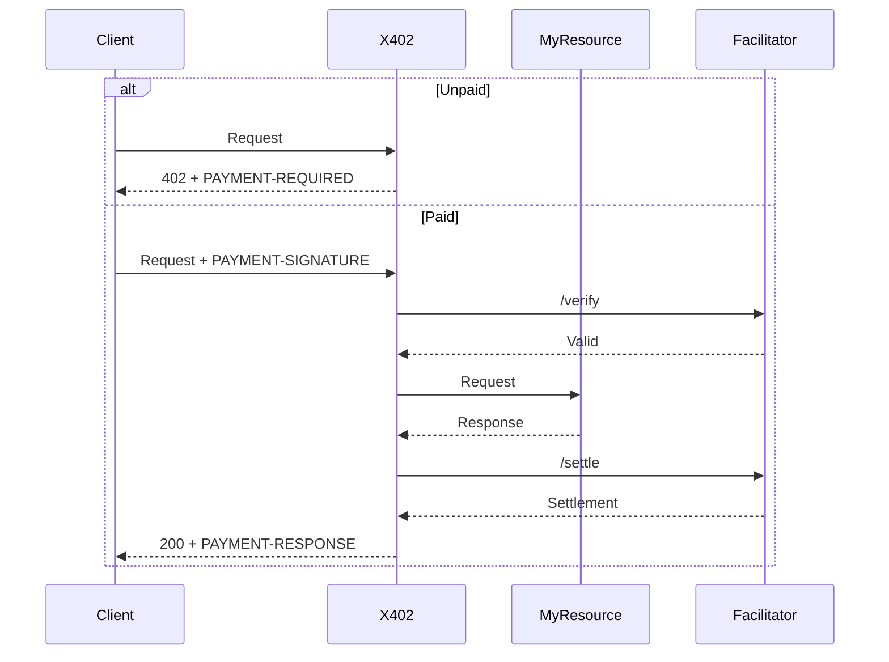

# X402

## Summary

The X402 middleware charges for resources using the [x402 protocol](https://github.com/coinbase/x402) (version 2). An unpaid request gets a `402 Payment Required` that says what to pay. A paid request is verified by a facilitator, handed to your resource, and settled once the resource responds. It is added to resources using a [resource group](/reference/standard/http/resource-group).

The highlighted section below shows how it is added:

<CodeTabs
  items={["Node", "Deno", "Bun", "Cloudflare Workers"]}
>
<CodeTab>

```js showLineNumbers  {8-18}
// Code is shortened for brevity

import { ResourceGroup } from "@drashland/drash/modules/http.polyfill.js";
import { X402 } from "@drashland/drash/modules/middleware/X402.js";

const group = ResourceGroup
  .builder()
  .middleware(X402({
    accepts: [{
      scheme: "exact",
      network: "eip155:84532",                              // Base Sepolia
      amount: "10000",                                      // 0.01 USDC (6 decimals)
      asset: "0x036CbD53842c5426634e7929541eC2318f3dCF7e",  // USDC
      payTo: "0xYourWalletAddress",
      maxTimeoutSeconds: 60,
      extra: { name: "USDC", version: "2" },
    }],
    facilitator_url: "https://facilitator.example.com",
  }))
  .resources(PremiumData)
  .build();
```

</CodeTab>
<CodeTab>

```ts showLineNumbers  {8-18}
// Code is shortened for brevity

import { ResourceGroup } from "jsr:@drashland/drash/modules/http.native";
import { X402 } from "jsr:@drashland/drash/modules/middleware/X402";

const group = ResourceGroup
  .builder()
  .middleware(X402({
    accepts: [{
      scheme: "exact",
      network: "eip155:84532",                              // Base Sepolia
      amount: "10000",                                      // 0.01 USDC (6 decimals)
      asset: "0x036CbD53842c5426634e7929541eC2318f3dCF7e",  // USDC
      payTo: "0xYourWalletAddress",
      maxTimeoutSeconds: 60,
      extra: { name: "USDC", version: "2" },
    }],
    facilitator_url: "https://facilitator.example.com",
  }))
  .resources(PremiumData)
  .build();
```

</CodeTab>
<CodeTab>

```ts showLineNumbers  {8-18}
// Code is shortened for brevity

import { ResourceGroup } from "@drashland/drash/modules/http.polyfill.js";
import { X402 } from "@drashland/drash/modules/middleware/X402.js";

const group = ResourceGroup
  .builder()
  .middleware(X402({
    accepts: [{
      scheme: "exact",
      network: "eip155:84532",                              // Base Sepolia
      amount: "10000",                                      // 0.01 USDC (6 decimals)
      asset: "0x036CbD53842c5426634e7929541eC2318f3dCF7e",  // USDC
      payTo: "0xYourWalletAddress",
      maxTimeoutSeconds: 60,
      extra: { name: "USDC", version: "2" },
    }],
    facilitator_url: "https://facilitator.example.com",
  }))
  .resources(PremiumData)
  .build();
```

</CodeTab>
<CodeTab>

```js showLineNumbers  {8-18}
// Code is shortened for brevity

import { ResourceGroup } from "@drashland/drash/modules/http.native.js";
import { X402 } from "@drashland/drash/modules/middleware/X402.js";

const group = ResourceGroup
  .builder()
  .middleware(X402({
    accepts: [{
      scheme: "exact",
      network: "eip155:84532",                              // Base Sepolia
      amount: "10000",                                      // 0.01 USDC (6 decimals)
      asset: "0x036CbD53842c5426634e7929541eC2318f3dCF7e",  // USDC
      payTo: "0xYourWalletAddress",
      maxTimeoutSeconds: 60,
      extra: { name: "USDC", version: "2" },
    }],
    facilitator_url: "https://facilitator.example.com",
  }))
  .resources(PremiumData)
  .build();
```

</CodeTab>
</CodeTabs>

Like the other pre-built middleware, `X402` is a __factory__. Calling it returns a middleware class with your options already bound to it.

## Configuring Options

### The Defaults

| Option            | Type                    | Default                          | Notes                                              |
| ----------------- | ----------------------- | -------------------------------- | -------------------------------------------------- |
| `accepts`         | `PaymentRequirements[]` | None (required)                  | The payment methods the resource accepts           |
| `facilitator_url` | `string`                | None (required)                  | Base URL of the facilitator's `/verify` and `/settle` |
| `description`     | `string`                | `""`                             | Sent to the client in `PAYMENT-REQUIRED`           |
| `mime_type`       | `string`                | `""`                             | Sent to the client in `PAYMENT-REQUIRED`           |
| `fetch`           | `typeof fetch`          | The global `fetch`               | Used to call the facilitator                       |

`accepts` entries use the x402 field names (`payTo`, `maxTimeoutSeconds`) because they are sent to clients as is.

### Accepting More Than One Payment Method

The client picks one entry from `accepts` and pays with it. List several to accept several networks or tokens:

```typescript showLineNumbers
const BASE_USDC = "0x833589fCD6eDb6E08f4c7C32D4f71b54bdA02913";         // USDC on Base
const BASE_SEPOLIA_USDC = "0x036CbD53842c5426634e7929541eC2318f3dCF7e"; // USDC on Base Sepolia
const payTo = "0xYourWalletAddress";

X402({
  accepts: [
    { scheme: "exact", network: "eip155:8453", amount: "10000", asset: BASE_USDC, payTo, maxTimeoutSeconds: 60 },
    { scheme: "exact", network: "eip155:84532", amount: "10000", asset: BASE_SEPOLIA_USDC, payTo, maxTimeoutSeconds: 60 },
  ],
  facilitator_url: "https://facilitator.example.com",
});
```

A payment is matched to an entry by `scheme`, `network`, `amount`, `asset`, and `payTo`. A payment that matches none is rejected with a `402` before the facilitator is called.

### Calling the Facilitator

`fetch` is how the middleware reaches the facilitator. Pass your own to add credentials a hosted facilitator requires:

```typescript showLineNumbers
X402({
  accepts,
  facilitator_url: "https://facilitator.example.com",
  fetch: (input, init) =>
    fetch(input, {
      ...init,
      headers: { ...init?.headers, Authorization: `Bearer ${API_KEY}` },
    }),
});
```

## How It Works

### TLDR

The middleware reads the `PAYMENT-SIGNATURE` header, has the facilitator verify it, calls your resource, then has the facilitator settle the payment. The response comes back with a `PAYMENT-RESPONSE` header carrying the settlement.

### Detailed Explanation

Every x402 header holds base64-encoded JSON:

| Header              | Direction        | Holds                                                 |
| ------------------- | ---------------- | ----------------------------------------------------- |
| `PAYMENT-REQUIRED`  | Server to client | What to pay: `{ x402Version, error, resource, accepts }` |
| `PAYMENT-SIGNATURE` | Client to server | The payment: `{ x402Version, accepted, payload }`     |
| `PAYMENT-RESPONSE`  | Server to client | The settlement: `{ success, transaction, network, payer }` |

The middleware answers with:

| Status | When                                                                             |
| ------ | -------------------------------------------------------------------------------- |
| `402`  | No `PAYMENT-SIGNATURE`, a payment matching no `accepts` entry, a failed verify, or a failed settle |
| `400`  | `PAYMENT-SIGNATURE` is not base64 JSON or is not a payment payload               |
| `500`  | The facilitator cannot be reached or does not answer with JSON                   |

`402` and `400` are thrown as an `X402ErrorResponse` carrying the `PAYMENT-REQUIRED` header, so the client can retry with a payment. The `500` is a plain `HTTPError`.

Settlement happens __after__ your resource. A response with a status of `400` or above is sent back unsettled, so a client is not charged for an error.

### State and Scope

The middleware keeps no state. Verification and settlement, including replay protection, are the facilitator's job.

### Data Flow

<Diagram>

</Diagram>

An unpaid request stops at the middleware. Your resource is never called.

## Extending This Middleware

The module exports the class as well as the factory, so you can extend it:

```typescript showLineNumbers
import { X402Middleware } from "@drashland/drash/modules/middleware/X402.js";

class LoggedX402 extends X402Middleware {
  constructor() {
    // Your options go here, the same ones you would pass to X402().
    super({ accepts, facilitator_url });
  }

  public override ALL(request: Request) {
    console.log(`Paid: ${request.headers.has("PAYMENT-SIGNATURE")}`);

    // Hand it back to the original middleware and get out of the way.
    return super.ALL(request);
  }
}
```

| Export           | What It Is                                         |
| ---------------- | -------------------------------------------------- |
| `X402`           | The factory. Returns a configured middleware class |
| `X402Middleware` | The middleware class itself, for extending         |
| `X402Header`     | The x402 header names                              |
| `defaultOptions` | The defaults listed above                          |
| `Options`        | The options type                                   |

## Related Files

`X402.ts` is the middleware. The files it is built from live in `modules/middleware/x402/`.

### `X402ErrorResponse`

```ts
import { X402ErrorResponse } from "@drashland/drash/modules/middleware/x402/X402ErrorResponse.js";

constructor(status: ResponseStatus, response: Response)
```

Extends [`HTTPError`](/reference/core/errors/http-error), carrying the `Response` the middleware already built alongside the status.

**This is the one worth knowing about in a `.catch()` block.** Return `error.response` to send the client the `PAYMENT-REQUIRED` header it needs to pay:

```ts
chain
  .handle(request)
  .catch((error) => {
    if (error instanceof X402ErrorResponse) {
      return error.response;
    }

    // ...your usual HTTPError handling
  });
```

### `Types`

```ts
import type { PaymentRequirements } from "@drashland/drash/modules/middleware/x402/Types.js";
```

The x402 message types, named as in the specification: `PaymentRequired`, `PaymentRequirements`, `PaymentPayload`, `ResourceInfo`, `FacilitatorRequest`, `VerifyResponse`, and `SettleResponse`. Also exports `X402_VERSION` (`2`).

### `Encoding`

```ts
import { decode, encode } from "@drashland/drash/modules/middleware/x402/Encoding.js";
```

| Function        | Notes                                                    |
| --------------- | -------------------------------------------------------- |
| `encode(value)` | JSON-serializes `value` and base64-encodes it as UTF-8.  |
| `decode(value)` | Reverses `encode`. Throws on invalid base64 or JSON.     |

Use these to read the `PAYMENT-REQUIRED` and `PAYMENT-RESPONSE` headers in a client or a test.
